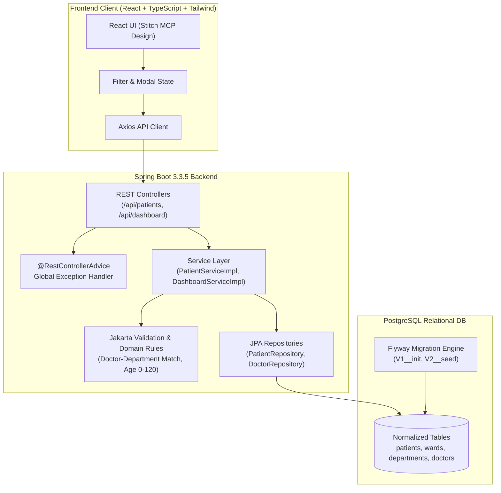
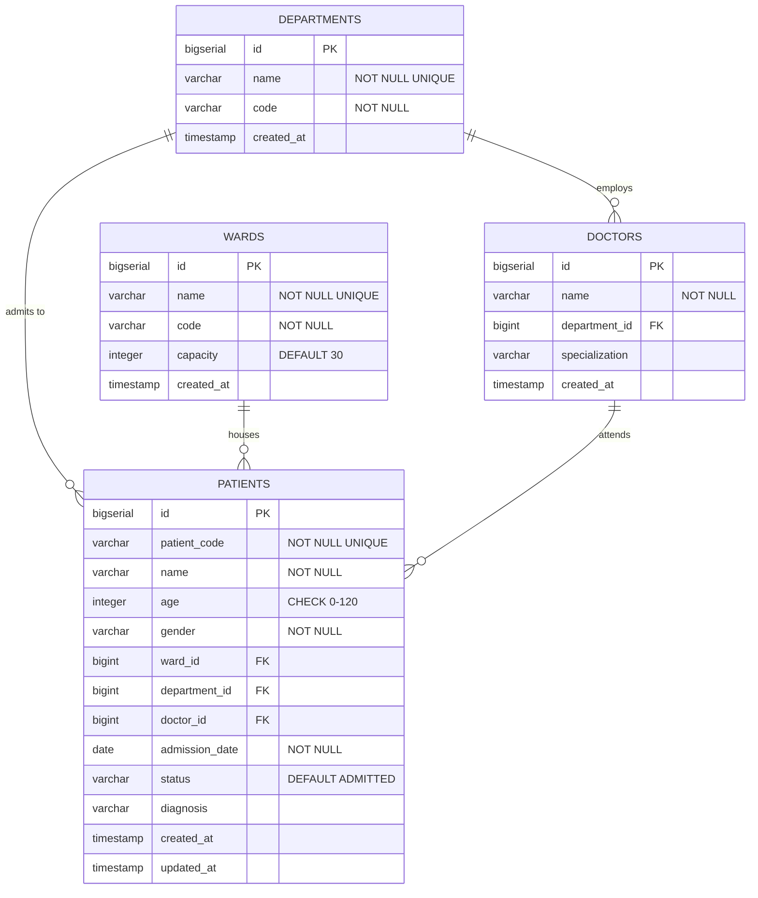

# MediFlow – Patient Admission Management System

> **A Production-Grade Healthcare SaaS Application for Hospital Intake, Inpatient Tracking, and Clinical Bed Allocation.**  
> Built for the **DScribe Software Engineer Intern Evaluation**.

[](https://github.com)
[](https://www.oracle.com/java/)
[](https://spring.io/projects/spring-boot)
[](https://www.postgresql.org/)
[](https://react.dev/)
[](https://tailwindcss.com/)
[](LICENSE)

---

## 1. Project Overview

**MediFlow** is a modern, clinical-grade Patient Admission Management System engineered for hospital administrative staff, triage officers, and clinical department heads. Operating in high-density medical environments where clarity and data integrity are critical, MediFlow eliminates admission errors, enforces referential department-doctor allocation rules, tracks facility occupancy in real time, and streamlines patient lifecycle management from intake to safe discharge.

Unlike standard generic CRUD systems, MediFlow is designed as a specialized **healthcare SaaS platform**—incorporating an 8px rhythmic clinical grid, strict server-side validation against malicious or malformed inputs, atomic Flyway schema migrations, and zero-compromise database normalization.

---

## 2. Problem Statement

Hospitals handle dynamic daily admissions across specialized clinical wards (Cardiology, ICU, Orthopedics, Pulmonology, Neurology). Traditional administrative systems suffer from:
- **Mismatched Doctor-Department Assignments**: Admitting doctors from Neurology to treat Cardiology patients without structural constraint enforcement.
- **Inconsistent Intake Validation**: Permitting future admission dates, numeric/special characters in patient names, or improper discharge duplications.
- **Cognitive Overload**: Crowded, unreadable dashboard metrics lacking clear ward occupancy signals.
- **Fragile State Synchronization**: Client-side mocking that conceals database failures.

MediFlow solves these challenges through strict **multi-layered architecture**:
- **Layer 1: Design-First Stitch MCP Integration** guaranteeing accessibility, clinical color semantics, and responsive layout across desktop, tablet, and mobile.
- **Layer 2: Domain-Enforced Spring Boot REST API** preventing illegal state transitions and data anomalies.
- **Layer 3: Fully Normalized PostgreSQL Relational Engine** governed by automated Flyway versioned migrations.

---

## 3. Core Features

| Feature | Description |
| :--- | :--- |
| **1. Executive Hospital Dashboard** | Real-time calculations of Total Patients, Currently Admitted, Discharged Patients, and Today's Admissions. Includes ward occupancy progress meters and department workload distributions. |
| **2. Clinical Patient Registry** | High-density data table tracking Patient Code, Name, Age, Gender, Ward, Department, Assigned Doctor, Admission Date, and Status. |
| **3. Multi-Parameter Filter Engine** | Live debounced search by name/MRN with instant dropdown filtering by Ward, Department, Doctor, and Status. |
| **4. Strict Cross-Department Doctor Validation** | Dynamic client dropdowns and backend service checks guaranteeing that selected doctors strictly belong to the patient's assigned department. |
| **5. Patient Admission Workflow** | Modal intake form with regex letter enforcement, age boundary bounds (0–120), future-date rejection, and auto-generated `#PAT-100X` identifier. |
| **6. Patient Record Modification** | In-place updates of patient demographics, bed re-allocation, and diagnosis notes. |
| **7. Safe Discharge Lifecycle Transition** | Atomic `PATCH /api/patients/{id}/discharge` updating status to `DISCHARGED` while preserving admission timestamps and rejecting duplicate discharge operations (HTTP 409). |
| **8. Destructive Action Confirmation** | Permanent deletion confirmation dialog preventing accidental deletion of clinical records. |

---

## 4. Technology Stack

### Frontend
- **Framework**: React.js 19 with Vite & TypeScript
- **Styling**: Tailwind CSS v4 with custom healthcare palette
- **Design Reference**: Generated via **Stitch MCP** (`MediFlow Clinical` Design System)
- **Icons**: Lucide React
- **HTTP Client**: Axios with centralized error interceptors
- **Testing**: Vitest + React Testing Library + JSDOM

### Backend
- **Language & Runtime**: Java 17+ (Java 23 verified)
- **Framework**: Spring Boot 3.3.5
- **Modules**: Spring Web, Spring Data JPA, Hibernate, Jakarta Bean Validation, Spring Boot Actuator
- **Database Migrations**: Flyway Core & Flyway PostgreSQL
- **Testing**: JUnit 5, Mockito, AssertJ, H2 in-memory test database

### Database & Infrastructure
- **Relational DB**: PostgreSQL 16+ / 18
- **Containerization**: Docker & Docker Compose multi-stage builds
- **Cloud Deployment**: Vercel (Frontend), Render (Backend + Managed PostgreSQL)
- **CI/CD**: GitHub Actions automated build and test pipeline

---

## 5. Architecture Overview

MediFlow enforces a strict layered backend separation of concerns:

$$\text{Client (React)} \longleftrightarrow \text{Controller (REST DTO)} \longleftrightarrow \text{Service (Business Logic)} \longleftrightarrow \text{Repository (Spring Data JPA)} \longleftrightarrow \text{PostgreSQL (Flyway)}$$



---

## 6. Database Schema & Relational Design

The database schema is fully normalized in 3NF with foreign key constraints, cascading restrictions, and query indexes.



---

## 7. API Documentation

### Base URL: `/api`

| Method | Endpoint | Description | Status Code |
| :--- | :--- | :--- | :--- |
| `GET` | `/patients` | Get paginated list of patients with search & filters | `200 OK` |
| `GET` | `/patients/{id}` | Get detailed single patient record | `200 OK` / `404 Not Found` |
| `POST` | `/patients` | Admit new patient with full validation | `201 Created` / `400 Bad Request` |
| `PUT` | `/patients/{id}` | Update patient demographics or bed assignment | `200 OK` / `400 Bad Request` |
| `PATCH`| `/patients/{id}/discharge` | Mark patient as discharged (preserves admission date) | `200 OK` / `409 Conflict` |
| `DELETE`| `/patients/{id}` | Permanently delete patient record | `200 OK` / `404 Not Found` |
| `GET` | `/dashboard/summary` | Real-time statistics, occupancy, & department workload | `200 OK` |
| `GET` | `/wards` | List all clinical wards and capacities | `200 OK` |
| `GET` | `/departments` | List all clinical specialties | `200 OK` |
| `GET` | `/doctors` | List doctors (supports `?departmentId={id}`) | `200 OK` |
| `GET` | `/health` | System health check and uptime ping | `200 OK` |

### Sample JSON Error Response (HTTP 400 Validation Error)
```json
{
  "success": false,
  "message": "Selected doctor 'Dr. Alexander Vance' does not belong to department 'Cardiology'",
  "errors": {
    "doctor": "Selected doctor 'Dr. Alexander Vance' does not belong to department 'Cardiology'"
  }
}
```

---

## 8. Local Installation & Setup

### Prerequisites
- Java 17+ (JDK)
- Maven 3.8+ (or IntelliJ Maven bundled)
- Node.js 18+ & npm 9+
- PostgreSQL 14+ running locally (or Docker)

### 1. Database Setup
Ensure PostgreSQL is running, then create the database:
```sql
CREATE DATABASE mediflow;
```

### 2. Backend Setup
Navigate to the `backend` directory:
```bash
cd backend
```
Configure environment variables if different from defaults (`application.yml` defaults to `localhost:5432/mediflow`, user: `postgres`, password: `postgres`):
```bash
# Windows PowerShell
$env:DATABASE_URL="jdbc:postgresql://localhost:5432/mediflow"
$env:DB_USERNAME="postgres"
$env:DB_PASSWORD="your_password"

# Run Spring Boot (Flyway automatically migrates the database schema & seeds reference data)
mvn spring-boot:run
```
The backend API will start at: `http://localhost:8080/api`  
Actuator health check: `http://localhost:8080/actuator/health`

### 3. Frontend Setup
Navigate to the `frontend` directory:
```bash
cd ../frontend

# Install dependencies
npm install

# Start development server
npm run dev
```
Open `http://localhost:5173` in your browser.

---

## 9. Docker Compose (One-Click Local Deployment)

To spin up the entire production stack (PostgreSQL + Spring Boot Backend + React Nginx Frontend) with a single command:

```bash
docker compose up --build
```
- Frontend: `http://localhost:3000`
- Backend API: `http://localhost:8080/api`
- PostgreSQL: `localhost:5432`

---

## 10. Automated Testing

### Backend Unit & Validation Tests (JUnit 5 + Mockito)
```bash
cd backend
mvn test
```
**Test Coverage Includes:**
- `PatientServiceTest`: Successful creation, generated patient codes, invalid ward rejection, invalid department rejection, invalid doctor rejection, cross-department doctor validation, future admission date rejection, patient update, safe discharge, duplicate discharge conflict (HTTP 409), and deletion.
- `PatientValidationTest`: Bean validation tests for blank names, numbers in names, negative age, age > 120, invalid gender, and future dates.

### Frontend Component Tests (Vitest + Testing Library)
```bash
cd frontend
npm test
```
**Test Coverage Includes:**
- Status badge clinical color rendering (Emerald vs Slate)
- KPI StatCard rendering and trend indicator display
- Empty state rendering and reset trigger
- Confirmation dialog cancel and destructive deletion callbacks
- Table rendering, patient row mapping, and action triggers

---

## 11. Production Deployment Guide

### Backend (Render / Railway / AWS ECS)
1. Link GitHub repository to Render as a **Web Service**.
2. Select Root Directory: `backend`.
3. Environment: `Docker` (or Java Runtime with `mvn clean package`).
4. Set Environment Variables:
   - `PORT`: `8080`
   - `DATABASE_URL`: `jdbc:postgresql://<managed-host>:5432/<dbname>`
   - `DB_USERNAME`: `<db-user>`
   - `DB_PASSWORD`: `<db-password>`
   - `FRONTEND_URL`: `https://your-frontend.vercel.app`
5. Health Check Path: `/api/health`.

### Frontend (Vercel / Netlify)
1. Import repository into Vercel.
2. Select Root Directory: `frontend`.
3. Framework Preset: `Vite`.
4. Environment Variables:
   - `VITE_API_BASE_URL`: `https://your-backend.onrender.com/api`
5. Deploy. The `vercel.json` rewrite file handles SPA client-side routing.

---

## 12. Project Structure

```text
mediflow-patient-admission-management/
│
├── .github/
│   └── workflows/
│       └── ci.yml               # Automated GitHub Actions CI workflow
│
├── backend/
│   ├── src/main/java/com/mediflow/
│   │   ├── config/              # WebConfig & CORS settings
│   │   ├── controller/          # Patient, Dashboard, ReferenceData, Health
│   │   ├── dto/                 # Request & Response DTOs
│   │   ├── entity/              # Patient, Ward, Department, Doctor JPA entities
│   │   ├── exception/           # GlobalExceptionHandler & custom exceptions
│   │   ├── repository/          # Spring Data JPA repositories
│   │   ├── service/             # PatientService, DashboardService, ReferenceDataService
│   │   ├── specification/       # Type-safe dynamic JPA Criteria specifications
│   │   └── MediflowApplication.java
│   │
│   ├── src/main/resources/
│   │   ├── db/migration/        # Flyway schema (V1__init, V2__seed)
│   │   └── application.yml      # Externalized configuration
│   ├── src/test/                # JUnit 5 & Mockito test suite
│   ├── Dockerfile
│   └── pom.xml
│
├── frontend/
│   ├── src/
│   │   ├── components/          # Sidebar, Header, Table, Modals, StatCards, Badges
│   │   ├── pages/               # DashboardPage, PatientsPage
│   │   ├── services/            # Axios API clients
│   │   ├── types/               # TypeScript interfaces
│   │   ├── test/                # Vitest & Testing Library tests
│   │   ├── App.tsx              # App Shell & Toast notification manager
│   │   └── main.tsx
│   ├── Dockerfile
│   ├── nginx.conf
│   ├── package.json
│   ├── tailwind.config.js
│   ├── tsconfig.json
│   └── vercel.json
│
├── docker-compose.yml           # Complete containerized multi-service deployment
├── render.yaml                  # Infrastructure-as-code for Render
├── README.md
├── .gitignore
└── .env.example
```

---

## 13. Future Improvements
- **Real-Time WebSockets / SSE**: Push real-time bed transfer and occupancy alerts across nursing stations.
- **Role-Based Access Control (RBAC)**: Fine-grained permissions separating Doctor chart access from Admission Desk intake.
- **HL7 / FHIR Interoperability**: Export patient records using international healthcare data standards.

---

## 14. License
This project is developed under the **MIT License**.
