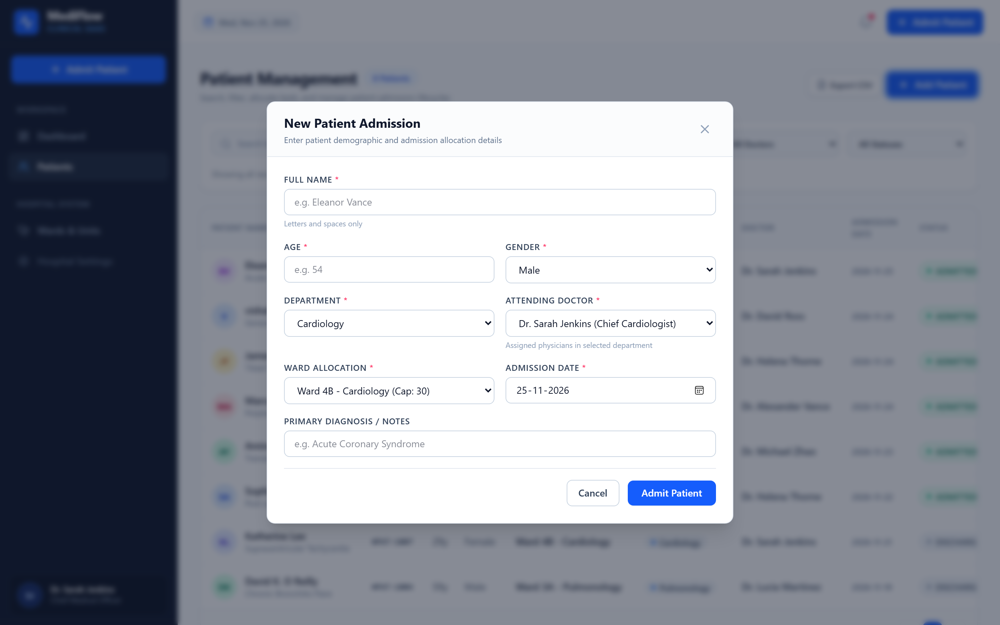
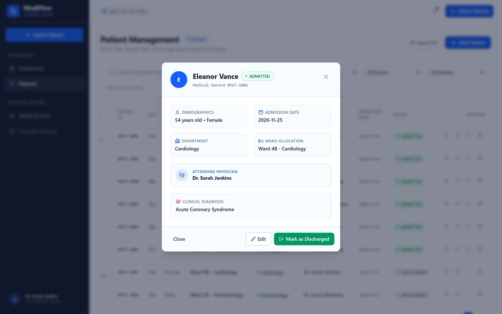
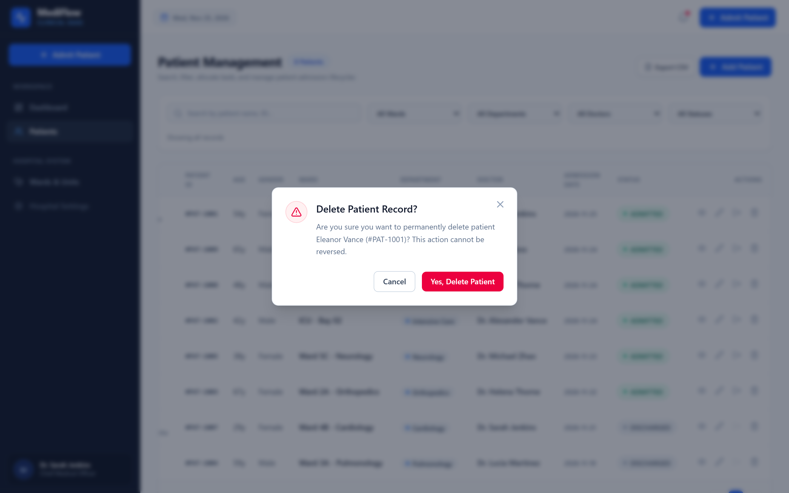
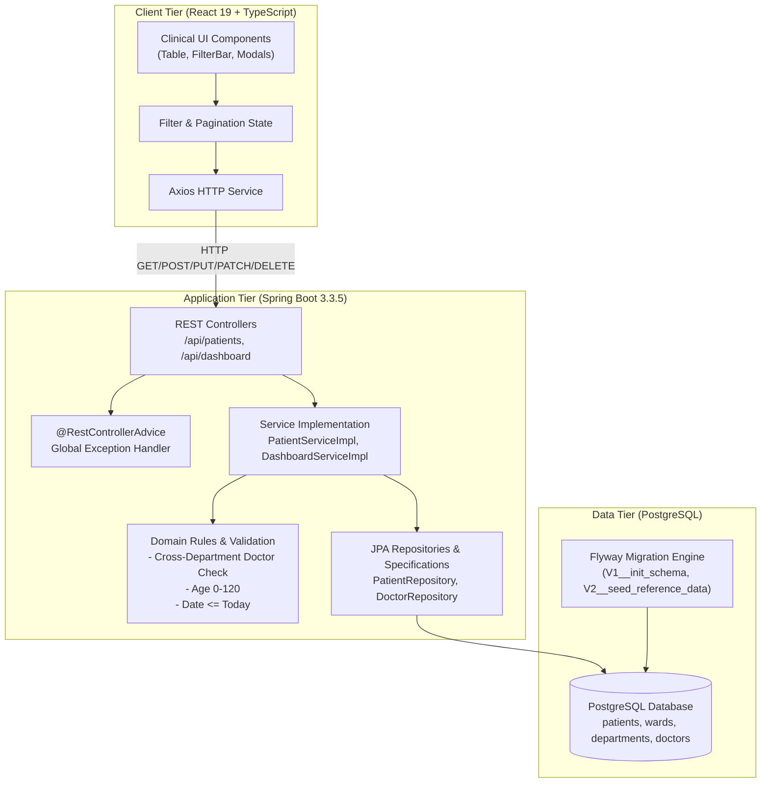
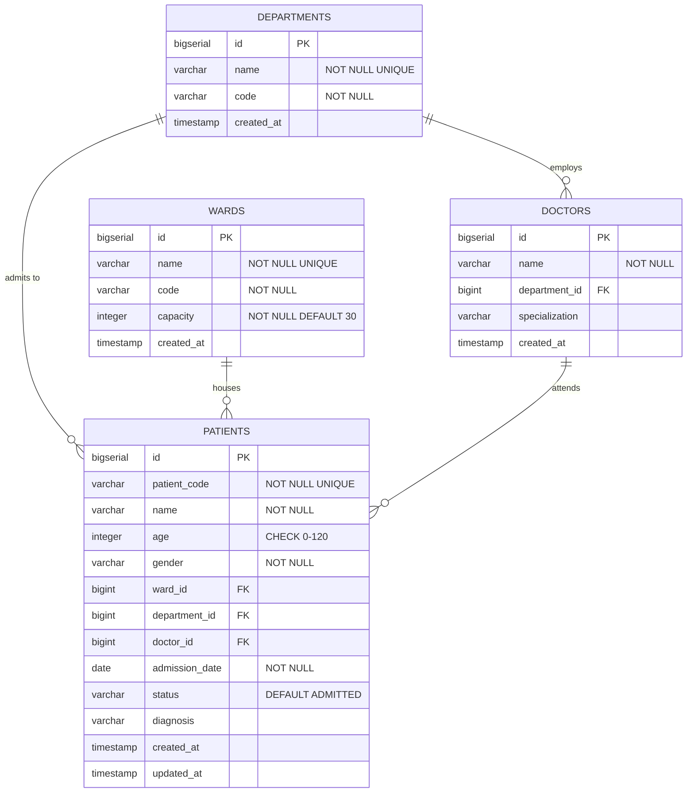

# MediFlow – Patient Admission Management System

> **A Clinical-Grade Healthcare SaaS Application for Hospital Intake, Inpatient Tracking, and Real-Time Bed Allocation.**  
> Built for the **DScribe Software Engineer Intern Evaluation**.

[](https://github.com/shivarajrathod08/mediflow-patient-admission-management/actions/workflows/ci.yml)
[](https://www.oracle.com/java/)
[](https://spring.io/projects/spring-boot)
[](https://www.postgresql.org/)
[](https://react.dev/)
[](https://tailwindcss.com/)
[](https://vitejs.dev/)
[](https://www.typescriptlang.org/)

---

## 1. Project Overview

**MediFlow** is a modern, high-density hospital administrative dashboard engineered for clinical triage officers, nursing administrators, and department coordinators. In fast-paced acute care environments, administrative inaccuracies directly impact clinical outcomes. MediFlow eliminates data entry errors, prevents doctor-department allocation mismatches, provides real-time facility bed occupancy tracking, and manages the end-to-end patient lifecycle from initial registration to safe discharge.

Unlike generic CRUD demos, MediFlow is engineered as a **reliable healthcare SaaS application**—featuring an 8px grid design system, strict multi-layered validation, atomic Flyway database schema migrations, and zero-compromise database normalization.

---

## 2. Live Application Links

| Resource | Status | URL |
| :--- | :--- | :--- |
| **Frontend Application** | `[Pending Deployment]` | *Will be updated upon public hosting deployment* |
| **Backend REST API** | `[Pending Deployment]` | *Will be updated upon public hosting deployment* |
| **GitHub Repository** | **Live** | [https://github.com/shivarajrathod08/mediflow-patient-admission-management](https://github.com/shivarajrathod08/mediflow-patient-admission-management) |

---

## 3. Application Screenshots

All screenshots below represent the **actual working application** running with real data and persistent PostgreSQL storage.

### Dashboard
Real-time census, 4 KPI metric cards, active bed utilization, recent admissions table, ward occupancy meters, and department distribution.


### Patient Management
Comprehensive patient registry with live search, multi-parameter dropdown filters (Ward, Department, Doctor, Status), status badges, and paginated controls.


### Add Patient
Admission intake modal with strict client-side validation hints, letter-only name constraints, and dynamic physician filtering based on selected department.


### Patient Details
Deep-dive clinical demographic overview, ward allocation, attending physician, and admission lifecycle actions.


### Edit Patient
Pre-populated patient record modification form for updating demographics, clinical diagnoses, and bed assignments.


### Delete Confirmation
Critical safety modal requiring deliberate confirmation before permanently deleting a clinical patient record.


### Mobile Dashboard
Fully responsive mobile dashboard view with stacked statistics cards, touch-optimized typography, and quick actions.


### Mobile Patient Management
Responsive mobile patient management interface with optimized horizontal scrolling and full-width search controls.


---

## 4. Key Features

### Mandatory Features Implemented
- **Add Patients**: Create admission records with auto-generated `#PAT-100X` identifier and default `ADMITTED` status.
- **View All Patients**: Paginated clinical table displaying name, ID, age, gender, ward, department, doctor, admission date, and status.
- **Search Functionality**: Live, debounced search by patient name or patient ID (case-insensitive).
- **Ward Filtering**: Instant filtering of inpatients across specialized wards (General, Orthopedics, Cardiology, Neurology, ICU).
- **Department Filtering**: Filter records by medical department (Cardiology, ICU, Neurology, Orthopedics, Pulmonology, Internal Medicine).
- **Doctor Filtering**: Filter records by attending physician, dynamically scoped to department.
- **Status Filtering**: Filter by `ADMITTED` or `DISCHARGED`.
- **Edit Patient Details**: In-place modification of existing patient demographics and clinical notes.
- **Delete Patient with Confirmation**: Safe two-step deletion preventing accidental loss of medical records.
- **Mark as Discharged**: Atomic transition to `DISCHARGED` status while preserving historical admission dates and rejecting duplicate discharge operations.
- **Responsive Interface**: Fluid layout designed for desktop (1440px+), tablet (768px), and mobile (390px) form factors.
- **Frontend Validation**: Instant UI feedback preventing malformed submissions before HTTP dispatch.
- **Backend Validation**: Strict server-side verification using Jakarta Bean Validation and business rules, ensuring requests cannot bypass rules via manual cURL/Postman calls.
- **Persistent Storage**: PostgreSQL database with automated Flyway versioned migrations.

### Additional Verified Capabilities
- **Cross-Department Doctor Validation**: Service-level enforcement verifying that the selected doctor strictly belongs to the chosen clinical department.
- **Ward Occupancy Meters**: Live calculation of admitted patients against total bed capacity per ward with utilization percentage bars.
- **Department Workload Distribution**: Real-time breakdown of inpatient volume across medical specialties.
- **CSV Data Export**: One-click client export of current patient records to formatted CSV files.
- **Spring Boot Actuator Health Check**: Production `/actuator/health` endpoint for uptime monitoring.

---

## 5. Technology Stack

### Frontend
- **React**: `19.3.1` (SPA framework)
- **Vite**: `8.3.6` (Build tool and development server)
- **TypeScript**: `~7.0.2` (Type safety and strict contract adherence)
- **Tailwind CSS**: `4.3.5` (Modern clinical styling system)
- **Lucide React**: `1.79.0` (Consistent healthcare iconography)
- **Axios**: `1.21.1` (Centralized HTTP client with error interception)
- **Testing**: `vitest 5.1.1` + `@testing-library/react 16.3.3` + `jsdom 29.1.1`

### Backend
- **Java**: `17+` (Verified on Oracle OpenJDK 23 / Temurin 17)
- **Spring Boot**: `3.3.5`
  - `spring-boot-starter-web`: RESTful controller architecture
  - `spring-boot-starter-data-jpa`: Object-relational mapping with Hibernate 6.5.3
  - `spring-boot-starter-validation`: Jakarta Bean Validation 3.0 API
  - `spring-boot-starter-actuator`: Health check and system metrics
- **Flyway**: `flyway-core` + `flyway-database-postgresql` (Versioned database migrations)
- **Build Tool**: Apache Maven `3.9.11`
- **Testing**: JUnit 5 + Mockito + AssertJ + H2 in-memory test database

### Database
- **PostgreSQL**: `16+` / `18.6`
- **Driver**: `postgresql 42.7.4`

### DevOps & Tooling
- **Containerization**: Multi-stage `Dockerfile` (Backend & Frontend) + `docker-compose.yml`
- **CI/CD**: GitHub Actions workflow (`.github/workflows/ci.yml`)
- **Web Server**: Nginx Alpine (Frontend container)

---

## 6. Architecture & Request Flow

MediFlow strictly follows a **layered software architecture** where business logic resides exclusively in the service layer, and database interactions are handled via JPA Criteria specifications.

```
React Frontend (Vite)
       │
       │ HTTP / REST (JSON)
       ▼
Spring Boot Controllers (PatientController, DashboardController)
       │
       ▼
Global Exception Handler (@RestControllerAdvice) ──▶ Structured Error DTOs
       │
       ▼
Service Layer (PatientServiceImpl, DashboardServiceImpl)
       │  ├── Jakarta Bean Validation (@Valid)
       │  └── Domain Rule Checks (Doctor-Department Matching, Age Bounds)
       ▼
Repository Layer (Spring Data JPA + PatientSpecification)
       │
       ▼
PostgreSQL Relational Database (Flyway Migrations V1 & V2)
```



---

## 7. Database Design & Relational Schema

The database is normalized into 3NF to ensure referential integrity, prevent redundant text allocations, and optimize indexed search queries.



### Table Descriptions & Integrity Constraints

| Table | Primary Key | Foreign Keys | Key Constraints & Indexes |
| :--- | :--- | :--- | :--- |
| **`departments`** | `id` (BIGSERIAL) | None | `name` is UNIQUE NOT NULL. |
| **`wards`** | `id` (BIGSERIAL) | None | `name` is UNIQUE NOT NULL, `capacity` defaults to 30. |
| **`doctors`** | `id` (BIGSERIAL) | `department_id` → `departments(id)` | Indexed on `department_id`. ON DELETE RESTRICT. |
| **`patients`** | `id` (BIGSERIAL) | `ward_id` → `wards(id)`<br>`department_id` → `departments(id)`<br>`doctor_id` → `doctors(id)` | `patient_code` is UNIQUE NOT NULL.<br>`age` CHECK (0 <= age <= 120).<br>Indexed on `LOWER(name)`, `status`, `admission_date`, `department_id`, and `ward_id`. |

---

## 8. Backend REST API Documentation

### Base Path: `/api`

### 1. Patient APIs
| Method | Endpoint | Query Parameters / Body | Status Codes | Description |
| :--- | :--- | :--- | :--- | :--- |
| `GET` | `/patients` | `search`, `wardId`, `departmentId`, `doctorId`, `status`, `page`, `size`, `sort` | `200 OK` | Retrieves paginated patient list with dynamic filtering. |
| `GET` | `/patients/{id}` | Path variable: `id` | `200 OK`, `404 Not Found` | Retrieves detailed information for a single patient. |
| `POST` | `/patients` | Body: `CreatePatientRequestDto` (JSON) | `201 Created`, `400 Bad Request` | Creates a new admission record; generates unique `#PAT-100X`. |
| `PUT` | `/patients/{id}` | Path: `id`, Body: `UpdatePatientRequestDto` | `200 OK`, `400 Bad Request`, `404 Not Found` | Updates patient demographics and assignments. |
| `PATCH`| `/patients/{id}/discharge` | Path variable: `id` | `200 OK`, `404 Not Found`, `409 Conflict` | Marks patient as `DISCHARGED`. Rejects duplicate discharges. |
| `DELETE`| `/patients/{id}` | Path variable: `id` | `200 OK`, `404 Not Found` | Permanently deletes a patient record. |

### 2. Dashboard APIs
| Method | Endpoint | Response | Status Codes | Description |
| :--- | :--- | :--- | :--- | :--- |
| `GET` | `/dashboard/summary` | `DashboardSummaryDto` | `200 OK` | Real-time counts (total, admitted, discharged, today), ward occupancy, and department distribution. |

### 3. Reference Data APIs
| Method | Endpoint | Query Parameters | Status Codes | Description |
| :--- | :--- | :--- | :--- | :--- |
| `GET` | `/wards` | None | `200 OK` | Lists all clinical wards and capacities. |
| `GET` | `/departments` | None | `200 OK` | Lists all medical departments. |
| `GET` | `/doctors` | `departmentId` (optional) | `200 OK` | Lists physicians, optionally filtered by department. |

### 4. Health & Observability APIs
| Method | Endpoint | Response | Status Codes | Description |
| :--- | :--- | :--- | :--- | :--- |
| `GET` | `/health` | `{"status": "UP", ...}` | `200 OK` | Application ping and health check. |
| `GET` | `/actuator/health` | Spring Actuator Health | `200 OK` | Detailed database connection and disk space check. |

---

## 9. Validation & Error Handling

### Mandatory Validation Matrix

| Field | Validation Rules | Enforcement Mechanism |
| :--- | :--- | :--- |
| **Patient Name** | Required. Letters and spaces only (`^[\\p{L} .'-]+$`). 2 to 100 characters. No digits or symbols. | Client form validation + Jakarta `@NotBlank`, `@Size`, `@Pattern` |
| **Age** | Required. Numeric integer. Minimum `0`, Maximum `120`. | Client input `min="0" max="120"` + Jakarta `@NotNull`, `@Min(0)`, `@Max(120)` |
| **Gender** | Required. Must match `Male`, `Female`, or `Other`. | Client `<select>` + Jakarta `@Pattern` (case-insensitive) |
| **Ward** | Required. Must reference an existing active ward. | Client dropdown + Service-level `WardRepository.findById()` check |
| **Department** | Required. Must reference an existing department. | Client dropdown + Service-level `DepartmentRepository.findById()` check |
| **Doctor** | Required. Must reference an existing physician. **Must belong to the selected department.** | Client dynamic filtering + Service-level `doctor.getDepartment().getId().equals(deptId)` verification |
| **Admission Date** | Required. Valid date format. **Must not be in the future** ($\le \text{today}$). | Client date picker `max="YYYY-MM-DD"` + Jakarta `@PastOrPresent` |
| **Status** | Defaults to `ADMITTED` on creation. Valid values: `ADMITTED` or `DISCHARGED`. | Service assignment on creation + Enum validation on update |

### Server-Side Defense Against Direct HTTP Bypasses
If a client attempts to bypass frontend validation using tools such as cURL or Postman, the Spring Boot backend intercepts and rejects the request via `@RestControllerAdvice` in `GlobalExceptionHandler.java`.

#### Example: Malformed Request Payload
```bash
curl -X POST http://localhost:8080/api/patients \
  -H "Content-Type: application/json" \
  -d '{"name":"John123","age":150,"gender":"Alien","wardId":1,"departmentId":1,"doctorId":2,"admissionDate":"2029-01-01"}'
```

#### Actual Server Response (HTTP 400 Bad Request):
```json
{
  "success": false,
  "message": "Admission date cannot be in the future",
  "errors": {
    "name": "Patient name must contain only letters and allowed separators (spaces, dots, hyphens)",
    "age": "Age must not exceed 120",
    "gender": "Gender must be Male, Female, or Other",
    "admissionDate": "Admission date cannot be in the future"
  }
}
```

#### Example: Cross-Department Doctor Mismatch
If a valid request sends Doctor ID `2` (Neurology) for Department ID `1` (Cardiology):
```json
{
  "success": false,
  "message": "Selected doctor 'Dr. Alexander Vance' does not belong to department 'Cardiology'"
}
```

---

## 10. Project Structure

```text
mediflow-patient-admission-management/
│
├── .github/
│   └── workflows/
│       └── ci.yml               # Automated GitHub Actions CI workflow
│
├── backend/
│   ├── src/
│   │   ├── main/
│   │   │   ├── java/com/mediflow/
│   │   │   │   ├── config/              # WebConfig (CORS settings)
│   │   │   │   ├── controller/          # REST Controllers
│   │   │   │   ├── dto/                 # Request & Response DTOs
│   │   │   │   ├── entity/              # JPA Entities (Patient, Ward, Doctor, Department)
│   │   │   │   ├── exception/           # GlobalExceptionHandler & custom exceptions
│   │   │   │   ├── repository/          # Spring Data JPA repositories
│   │   │   │   ├── service/             # Service contracts and implementations
│   │   │   │   ├── specification/       # Type-safe dynamic JPA Criteria specifications
│   │   │   │   └── MediflowApplication.java
│   │   │   └── resources/
│   │   │       ├── db/migration/        # Flyway SQL migrations (V1 schema, V2 seed)
│   │   │       └── application.yml      # Environment-variable-driven configuration
│   │   └── test/
│   │       ├── java/com/mediflow/
│   │       │   ├── service/             # Unit tests (PatientServiceTest)
│   │       │   └── validation/          # Bean validation tests (PatientValidationTest)
│   │       └── resources/
│   │           └── application-test.yml # In-memory H2 test configuration
│   ├── .env.example
│   ├── Dockerfile
│   └── pom.xml
│
├── frontend/
│   ├── public/
│   │   └── favicon.svg
│   ├── src/
│   │   ├── components/          # Reusable UI components (Sidebar, Header, Table, Modals, Badges)
│   │   ├── pages/               # DashboardPage, PatientsPage
│   │   ├── services/            # Axios API client functions
│   │   ├── test/                # Vitest & Testing Library test suites
│   │   ├── types/               # TypeScript data models and interfaces
│   │   ├── App.tsx              # Root shell component & toast manager
│   │   ├── index.css            # Tailwind CSS imports & global styles
│   │   └── main.tsx             # Application entrypoint
│   ├── .env.example
│   ├── Dockerfile
│   ├── nginx.conf
│   ├── package.json
│   ├── postcss.config.js
│   ├── tailwind.config.js
│   ├── tsconfig.json
│   ├── vercel.json
│   └── vite.config.ts
│
├── screenshots/                 # 8 Genuine application screenshots
│   ├── add-patient.png
│   ├── dashboard.png
│   ├── delete-confirmation.png
│   ├── edit-patient.png
│   ├── mobile-dashboard.png
│   ├── mobile-patients.png
│   ├── patient-details.png
│   └── patient-management.png
│
├── .env.example                 # Root configuration template
├── .gitignore                   # Version control exclusion rules
├── docker-compose.yml           # Multi-container local orchestration
├── README.md                    # Project documentation
└── render.yaml                  # Render Blueprint deployment specification
```

---

## 11. Local Setup Instructions

### Prerequisites
- **Java Development Kit (JDK)**: Version 17 or higher (`java -version`)
- **Apache Maven**: Version 3.8+ (or Maven Wrapper)
- **Node.js**: Version 18+ and `npm` 9+ (`node -v`, `npm -v`)
- **PostgreSQL**: Version 14+ running locally (or via Docker)

---

### Step 1: Clone the Repository
```bash
git clone https://github.com/shivarajrathod08/mediflow-patient-admission-management.git
cd mediflow-patient-admission-management
```

---

### Step 2: Database Provisioning
Ensure your local PostgreSQL service is running, then create the `mediflow` database:
```sql
CREATE DATABASE mediflow;
```

---

### Step 3: Run the Spring Boot Backend

1. Navigate to the `backend` folder:
   ```bash
   cd backend
   ```
2. Verify or set environment variables:
   ```powershell
   # Windows PowerShell
   $env:PORT="8080"
   $env:DATABASE_URL="jdbc:postgresql://localhost:5432/mediflow"
   $env:DB_USERNAME="postgres"
   $env:DB_PASSWORD="your_postgres_password"
   $env:FRONTEND_URL="http://localhost:5173"
   ```
   ```bash
   # Linux / macOS
   export PORT=8080
   export DATABASE_URL=jdbc:postgresql://localhost:5432/mediflow
   export DB_USERNAME=postgres
   export DB_PASSWORD=your_postgres_password
   export FRONTEND_URL=http://localhost:5173
   ```
3. Start the application:
   ```bash
   mvn spring-boot:run
   ```
   *Flyway will automatically execute `V1__init_schema.sql` and `V2__seed_reference_data.sql`, creating all tables, indexes, and initial reference data.*
4. Verify backend health:
   ```bash
   curl http://localhost:8080/api/health
   ```

---

### Step 4: Run the React Frontend

1. In a separate terminal, navigate to the `frontend` folder:
   ```bash
   cd ../frontend
   ```
2. Ensure `.env` exists:
   ```env
   VITE_API_BASE_URL=http://localhost:8080/api
   ```
3. Install dependencies and start the development server:
   ```bash
   npm install
   npm run dev
   ```
4. Open your browser and navigate to:
   ```
   http://localhost:5173
   ```

---

## 12. Docker Compose (One-Click Setup)

To launch the complete isolated production environment (PostgreSQL + Spring Boot + React on Nginx) with a single command:

```bash
docker compose up --build
```
- **React Frontend**: `http://localhost:3000`
- **Spring Boot Backend**: `http://localhost:8080/api`
- **PostgreSQL Database**: `localhost:5432`

---

## 13. Running Automated Tests

### Backend Automated Tests (JUnit 5 + Mockito)
The backend test suite executes 18 automated tests covering business logic, domain rules, and Jakarta validation.
```bash
cd backend
mvn test
```
**Test Results:**
```
[INFO] Running com.mediflow.service.PatientServiceTest
[INFO] Tests run: 11, Failures: 0, Errors: 0, Skipped: 0
[INFO] Running com.mediflow.validation.PatientValidationTest
[INFO] Tests run: 7, Failures: 0, Errors: 0, Skipped: 0
[INFO] BUILD SUCCESS
```

### Frontend Automated Tests (Vitest + React Testing Library)
The frontend test suite tests component rendering, status badges, StatCards, empty states, confirmation dialogs, and table action callbacks.
```bash
cd frontend
npm test
```
**Test Results:**
```
 ✓ src/test/PatientManagement.test.tsx (5 tests)
 Test Files  1 passed (1)
      Tests  5 passed (5)
```

### Frontend Production Build Verification
```bash
cd frontend
npm run build
```
Generates an optimized, tree-shaken static production bundle in `dist/`.

---

## 14. Environment Variables Reference

### Root & Backend Configuration (`backend/.env.example`)
| Variable | Default Value | Description |
| :--- | :--- | :--- |
| `PORT` | `8080` | Port on which the Spring Boot web server listens. |
| `DATABASE_URL` | `jdbc:postgresql://localhost:5432/mediflow` | JDBC connection string to the PostgreSQL database. |
| `DB_USERNAME` | `postgres` | Database user account name. |
| `DB_PASSWORD` | `your_secure_password` | Database user account password. |
| `FRONTEND_URL` | `http://localhost:5173,http://localhost:3000` | Allowed CORS origins (comma-separated). |

### Frontend Configuration (`frontend/.env.example`)
| Variable | Default Value | Description |
| :--- | :--- | :--- |
| `VITE_API_BASE_URL` | `http://localhost:8080/api` | Base URL of the backend REST API. |

---

## 15. CI/CD Pipeline (GitHub Actions)

The repository includes an active GitHub Actions workflow at [`.github/workflows/ci.yml`](.github/workflows/ci.yml).

### Workflow Trigger Conditions:
- `push` to `main` or `master` branches
- `pull_request` to `main` or `master` branches

### Pipeline Stages:
1. **`backend-test-build`**:
   - Sets up JDK 17 (Temurin).
   - Resolves Maven dependencies with caching.
   - Executes `mvn clean test` across the full test suite.
2. **`frontend-test-build`**:
   - Sets up Node.js 20 with npm dependency caching.
   - Runs `npm ci`.
   - Executes Vitest unit tests via `npm test`.
   - Compiles production bundle with TypeScript check via `npm run build`.

*Note: This pipeline handles Continuous Integration (automated testing and build verification). Continuous Deployment (CD) can be hooked to hosting providers (Render/Vercel) via GitHub webhooks upon merging into `main`.*

---

## 16. Production Deployment Guide

### Backend: Render Deployment
1. Connect your GitHub repository to [Render](https://render.com/).
2. Create a new **PostgreSQL Database** on Render (Database name: `mediflow`).
3. Create a new **Web Service** with:
   - **Root Directory**: `backend`
   - **Environment**: `Docker` (or Java Runtime)
   - **Health Check Path**: `/api/health`
4. Set environment variables in the Render dashboard:
   - `PORT`: `8080`
   - `DATABASE_URL`: `jdbc:postgresql://<render-db-hostname>:5432/mediflow`
   - `DB_USERNAME`: `<render-db-user>`
   - `DB_PASSWORD`: `<render-db-password>`
   - `FRONTEND_URL`: `https://your-frontend-domain.vercel.app`

### Frontend: Vercel Deployment
1. Import your GitHub repository into [Vercel](https://vercel.com/).
2. Set **Root Directory** to `frontend`.
3. Set **Framework Preset** to `Vite`.
4. Configure Environment Variable:
   - `VITE_API_BASE_URL`: `https://your-backend-service.onrender.com/api`
5. Deploy. The included [`frontend/vercel.json`](frontend/vercel.json) automatically handles SPA client-side route rewrites.

---

## 17. Security Considerations

- **No Committed Secrets**: All credentials and connection strings are externalized through environment variables. `.gitignore` strictly excludes `.env` and sensitive configurations.
- **Strict Server-Side Validation**: Backend validation cannot be bypassed by client manipulation or raw HTTP requests.
- **Referential Integrity**: PostgreSQL foreign keys with `ON DELETE RESTRICT` prevent orphaned records and dangling references.
- **Parameterized SQL Execution**: Hibernate and JPA CriteriaBuilder use bound parameter queries, completely eliminating SQL injection vulnerabilities.
- **Cross-Origin Resource Sharing (CORS)**: WebConfig restricts origins strictly to allowed frontend URLs.
- **Sanitized Error Responses**: Internal stack traces and database credentials are never leaked in API error payloads.

---

## 18. Future Improvements

The following architectural enhancements are planned for future iterations:
- **Role-Based Access Control (RBAC)**: Distinguish Doctor permissions (chart notes, discharge orders) from Receptionist intake permissions.
- **Real-Time WebSockets**: Live bed transfer updates and ICU critical capacity alerts broadcast to nursing stations via STOMP/WebSocket.
- **Audit Logging**: Append-only audit trail tracking every modification to patient demographics.
- **HL7 / FHIR Standard Export**: Support for exporting patient clinical records in international healthcare interoperability formats.

---

## 19. Author

**Developed by Rathlavath Shivaraj**

- **GitHub**: [https://github.com/shivarajrathod08](https://github.com/shivarajrathod08)
- **LinkedIn**: [https://www.linkedin.com/in/rathavathshivaraj/](https://www.linkedin.com/in/rathavathshivaraj/)

---

## 20. License

This repository was created specifically for the **DScribe Software Engineer Intern Evaluation**. All rights reserved by the author.
